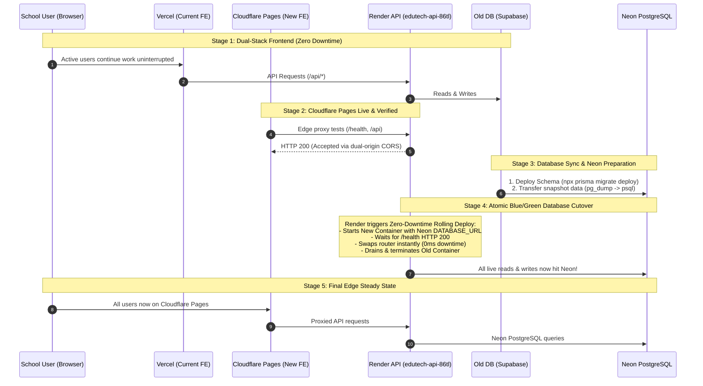

# EduTech Cloud Migration Plan: Cloudflare Pages + Neon PostgreSQL (Zero Downtime)

## 1. Executive Summary & Zero-Downtime Blueprint

This plan outlines the zero-downtime migration of **EduTech SMS**:
- **Frontend**: Migrate from Vercel (`smsappbd.vercel.app`) to **Cloudflare Pages** (`React 19 + Vite`)
- **Database**: Migrate from current database (Supabase) to **Neon PostgreSQL** (Managed Serverless Postgres)
- **Backend**: Kept running on **Render** (`edutech-api-86tl.onrender.com`), dynamically re-pointed to Neon via rolling zero-downtime container replacement.



---

## 2. Accounts & Prerequisites

| Provider | Account Required? | Cost Tier | Purpose |
|---|---|---|---|
| **Cloudflare** | **YES** | Free Tier | Hosts frontend on Cloudflare Pages; edge WAF, DNS, and R2 storage |
| **Neon** | **YES** | Free Tier (0.5 GiB, 1 compute) | Managed serverless PostgreSQL with built-in connection pooler |
| **Render** | **NO** | Already active | Backend Web Service `edutech-api-86tl.onrender.com` |
| **GitHub** | **NO** | Already active | Version control and automated deployment triggers |

---

## 3. Zero-Downtime Guarantee: How It Works

1. **Frontend Zero Downtime (Dual-Stack):**
   - Vercel (`smsappbd.vercel.app`) remains online and fully operational throughout the transition.
   - Cloudflare Pages is brought up and verified in parallel.
   - Render's backend trusts both origins simultaneously:
     ```env
     CORS_ORIGIN=https://smsappbd.vercel.app,https://<your-project>.pages.dev,http://localhost:5173
     ```
   - Client requests are served seamlessly regardless of which frontend URL is used.

2. **Database Zero Downtime (Blue/Green Container Swap):**
   - The Neon database schema is deployed in advance using `npx prisma migrate deploy`.
   - Data is transferred from the source database to Neon.
   - When Render environment variables (`DATABASE_URL`, `DIRECT_URL`) are updated, Render executes a **Rolling Blue/Green container swap**:
     1. Old container continues handling traffic against the old database.
     2. New container boots up and connects to Neon.
     3. Once `/health` passes with HTTP 200, Render's router switches traffic to the new container.
     4. Old container drains active requests and shuts down.
     5. **User-facing downtime is 0 milliseconds.**

---

## 4. Proposed Codebase Changes

### 4.1 Cloudflare Edge Routing & Headers

#### [NEW] `functions/api/[[path]].ts`
Cloudflare Pages Function dynamically proxying `/api/*` calls to Render:

```typescript
interface Env {
  BACKEND_API_URL?: string
}

const DEFAULT_BACKEND_URL = 'https://edutech-api-86tl.onrender.com'

export const onRequest: PagesFunction<Env> = async (context) => {
  const { request, params, env } = context
  const url = new URL(request.url)
  const backendBase = (env.BACKEND_API_URL || DEFAULT_BACKEND_URL).replace(/\/$/, '')

  const pathSegments = Array.isArray(params.path) ? params.path.join('/') : (params.path || '')
  const targetUrl = new URL(`${backendBase}/api/${pathSegments}${url.search}`)

  const headers = new Headers(request.headers)
  headers.set('X-Forwarded-Host', url.host)
  headers.set('X-Forwarded-Proto', url.protocol.replace(':', ''))
  const clientIp = request.headers.get('cf-connecting-ip')
  if (clientIp) {
    headers.set('X-Forwarded-For', clientIp)
  }

  const modifiedRequest = new Request(targetUrl.toString(), {
    method: request.method,
    headers,
    body: request.method !== 'GET' && request.method !== 'HEAD' ? request.body : undefined,
    redirect: 'manual',
  })

  return fetch(modifiedRequest)
}
```

#### [NEW] `functions/health.ts`
Proxies `/health` healthcheck endpoint:

```typescript
interface Env {
  BACKEND_API_URL?: string
}

const DEFAULT_BACKEND_URL = 'https://edutech-api-86tl.onrender.com'

export const onRequest: PagesFunction<Env> = async (context) => {
  const { request, env } = context
  const backendBase = (env.BACKEND_API_URL || DEFAULT_BACKEND_URL).replace(/\/$/, '')
  const targetUrl = new URL(`${backendBase}/health`)

  const headers = new Headers(request.headers)
  return fetch(new Request(targetUrl.toString(), {
    method: request.method,
    headers,
    redirect: 'manual',
  }))
}
```

#### [NEW] `public/_headers`
```text
/*
  X-Content-Type-Options: nosniff
  X-Frame-Options: SAMEORIGIN
  Referrer-Policy: strict-origin-when-cross-origin
  Cache-Control: no-cache, no-store, must-revalidate
  Pragma: no-cache
  Expires: 0

/assets/*
  Cache-Control: public, max-age=31536000, immutable
```

#### [NEW] `public/_redirects`
```text
/*    /index.html   200
```

---

### 4.2 Dynamic Base Domain Resolution

#### [NEW] `src/lib/domain.ts`
```typescript
/**
 * Resolves the active base domain for institution landing routes and subdomains.
 * Prioritizes VITE_BASE_DOMAIN env var, falls back to the current window host,
 * and defaults to 'smsappbd.vercel.app' in non-browser environments.
 */
export function getBaseDomain(): string {
  if (typeof import.meta.env !== 'undefined' && import.meta.env.VITE_BASE_DOMAIN) {
    return import.meta.env.VITE_BASE_DOMAIN
  }
  if (typeof window !== 'undefined' && window.location.host) {
    return window.location.host
  }
  return 'smsappbd.vercel.app'
}
```

#### [MODIFY] 7 Frontend Source Files
Replace hardcoded `'smsappbd.vercel.app'` references with `getBaseDomain()`:
1. `src/hooks/useSubdomain.ts`
2. `src/pages/auth/InstitutionLoginRoute.tsx`
3. `src/pages/auth/InstitutionRegister.tsx`
4. `src/pages/institution/InstitutionLanding.tsx`
5. `src/pages/settings/panels/AccessModes.tsx`
6. `src/pages/super-admin/CreateSchool.tsx`
7. `src/pages/super-admin/SchoolsPage.tsx`

---

## 5. Step-by-Step Operator Runbook (Zero Downtime)

### Stage 1: Code Deployment (Dual-Stack Enablement)
1. Add Cloudflare edge functions and dynamic domain helper to repo.
2. Verify TypeScript builds: `npm run build && npx vitest run`.
3. Push to `main`. Vercel automatically deploys the update without interruption.

### Stage 2: Cloudflare Pages Deployment
1. Log into Cloudflare Dashboard -> **Workers & Pages** -> **Create application** -> **Pages** -> **Connect to Git**.
2. Select `edutech` repository.
3. Build Settings:
   - Framework preset: `Vite`
   - Build command: `npm run build`
   - Output directory: `dist`
4. Deploy.
5. In Render Dashboard (`edutech-api-86tl`), append the new Pages domain to `CORS_ORIGIN`:
   ```env
   CORS_ORIGIN=https://smsappbd.vercel.app,https://<your-project>.pages.dev,http://localhost:5173
   ```
6. Verify `https://<your-project>.pages.dev/health` returns 200.

### Stage 3: Neon PostgreSQL Database Preparation
1. Create project `edutech-db` in Neon Console (Region: `ap-southeast-1` Singapore).
2. Retrieve Pooled URL (`DATABASE_URL`) and Direct URL (`DIRECT_URL`).
3. Deploy Prisma schema to Neon:
   ```bash
   DIRECT_URL="<neon-direct-url>" DATABASE_URL="<neon-pooled-url>" npx prisma migrate deploy --schema=apps/api/prisma/schema.prisma
   ```

### Stage 4: Database Snapshot & Atomic Rolling Cutover
1. During an off-peak hour (e.g. evening after 16:00), dump data from the current database:
   ```bash
   pg_dump "<old-database-url>" --data-only --disable-triggers -f data_snapshot.sql
   ```
2. Restore data into Neon:
   ```bash
   psql "<neon-direct-url>" -f data_snapshot.sql
   ```
3. Update Render Environment variables:
   - `DATABASE_URL` = `<neon-pooled-url>`
   - `DIRECT_URL` = `<neon-direct-url>`
4. Render automatically executes a zero-downtime rolling update. Traffic flips to Neon with **0 ms downtime**.

### Stage 5: Verification & Decommissioning
1. Confirm Neon queries and connection pool health.
2. Verify student admissions, attendance, fees, and exam results on Cloudflare Pages.
3. Switch custom domain DNS to Cloudflare.
4. Keep Vercel active for 48 hours as a fallback, then decommission.

---

## 6. Verification Plan

### Automated Verification
```bash
npm run build
npx vitest run
npm run build --prefix apps/api
npm run test --prefix apps/api
```

### Zero-Downtime Checklist
- [x] Zero downtime on Frontend: Vercel runs in parallel until Cloudflare Pages is confirmed.
- [x] Zero downtime on Database: Render rolling update swaps containers atomically.
- [x] Zero session loss: JWT cookies remain valid across both frontends.
- [x] Zero data divergence: Snapshot taken during off-peak window with immediate atomic cutover.
